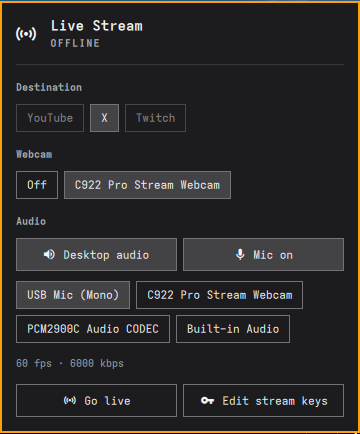

# Omarchy Stream

Go live to YouTube, X, Twitch or any RTMP(S) server straight from the Omarchy bar, without OBS.



Click the bar icon, pick a destination, monitor, webcam and microphone, then press **Go live**. Streaming runs on [gpu-screen-recorder](https://git.dec05eba.com/gpu-screen-recorder/about/), so encoding happens on the GPU.

## Features

- **Destinations:** YouTube, X and Twitch are preset, and you can add any RTMP or RTMPS server. Stream keys live in a private file and never go in `shell.json`.
- **Monitor:** stream any connected monitor.
- **Webcam overlay:** Omarchy's own webcam overlay appears in the corner of the streamed monitor. Show, hide or switch cameras while live, and resize with `Super+Alt+-` and `Super+Alt+=`.
- **Audio:** desktop audio and microphone are mixed into one track. While live you can turn desktop audio on or off, mute the mic, or switch microphones, all without restarting the stream.
- **Bar indicator:** the icon turns red and shows elapsed time while live, plus a mic-off glyph when muted. You get a notification when you go live and if the stream drops.

## Install

```bash
omarchy plugin add https://github.com/DavidHoenisch/omarchy-livestream --enable
```

The widget defaults to the `centerEnd` bar section (beside the clock). To move it:

```bash
omarchy bar move io.github.davidhoenisch.omarchystream --section right
```

## Set up stream keys

Open the panel and click **Edit stream keys**. This creates and opens
`~/.config/omarchy/livestream/keys.json` (mode `600`):

```json
{
  "youtube": { "name": "YouTube", "url": "rtmp://a.rtmp.youtube.com/live2", "key": "" },
  "x":       { "name": "X",       "url": "", "key": "" },
  "twitch":  { "name": "Twitch",  "url": "rtmp://live.twitch.tv/app", "key": "" }
}
```

Paste each platform's stream key. For X, also copy the RTMP URL from X Media Studio, because it differs per account. To add another server, add an entry: the id is lowercase letters, digits, `-` or `_`, and the URL must start with `rtmp://` or `rtmps://`.

## Usage

| Action | How |
|---|---|
| Open the panel | Click the bar icon |
| Go live / end stream | **Go live** in the panel, or middle-click the icon |
| Mute / unmute mic while live | Right-click the icon, or **Mic on/muted** in the panel |
| Desktop audio, mic or webcam | Panel; works before and during a stream |
| Edit stream keys | **Edit stream keys** in the panel |

Keybindable IPC commands:

```bash
omarchy-shell io.github.davidhoenisch.omarchystream toggleLive
omarchy-shell io.github.davidhoenisch.omarchystream toggleMute
omarchy-shell io.github.davidhoenisch.omarchystream toggleDesktopAudio
omarchy-shell io.github.davidhoenisch.omarchystream toggle   # panel
```

Widget settings (Omarchy bar settings, or `shell.json`):

| Key | Default | Meaning |
|---|---|---|
| `fps` | `60` | Frames per second |
| `bitrateKbps` | `6000` | Video bitrate (constant bitrate) |
| `webcamSize` | `medium` | Starting webcam overlay size: `small`, `medium`, `large` |

## How it works

`bin/livestream` is a small Bash helper. The panel only calls this helper; it doesn't run anything else.

- **Video:** `gpu-screen-recorder` captures the monitor and pushes H.264 + AAC in FLV over RTMP, with a 2-second keyframe interval.
- **Audio:** the helper creates a private PulseAudio/PipeWire null sink, `omarchy_livestream`. Desktop audio (the default output's monitor) and the chosen mic each feed it through their own loopback, and the stream records that sink. This is how audio can change mid-stream. Your default output device is left alone.
- **Webcam:** the same `mpv` `WebcamOverlay` window and Hyprland rules that `omarchy capture screenrecording` uses.
- **Cleanup:** state lives in `$XDG_RUNTIME_DIR/omarchy-livestream-$UID`. Ending the stream unloads the audio modules and closes the webcam.

## Dependencies

All of these ship with Omarchy:

- `gpu-screen-recorder`
- `pactl` (PipeWire's PulseAudio compatibility layer)
- `jq`
- `mpv`
- `v4l2-ctl` (`v4l-utils`)
- `hyprctl`
- `notify-send`
- Omarchy's `omarchy-capture-webcam-list`, `omarchy-capture-webcam-resize` and `omarchy-launch-editor`

## Security notes

- Stream keys are stored only in `~/.config/omarchy/livestream/keys.json`, mode `600`. Error messages shown in the panel have URLs removed.
- `gpu-screen-recorder` receives the stream URL, including the key, as a command-line argument, so other local users on a shared machine could see it in the process list.
- Plugins run unsandboxed inside the Omarchy shell. The plugin makes no network requests of its own; only the stream goes out.

## Remove

End any running stream first, then:

```bash
omarchy plugin remove io.github.davidhoenisch.omarchystream
```

This leaves your stream keys in place. To delete them too:

```bash
rm -rf ~/.config/omarchy/livestream
```

## License

[MIT](LICENSE)
